# Bench results: maestro-runner against upstream

Generated 2026-10-25 01:38 UTC.

*Test time* is a run's test steps added up, retry jobs included (no builds, no queue). The other columns are read per flow from the job logs; see [RETRIES.md](RETRIES.md). Upstream React Navigation runs agent-device; React Native and Expo run Maestro. Upstream React Native uses larger runners (macos-*-large, 8-core-ubuntu) than the bench fork. enriched-html and pager-view run no e2e upstream, so they show ours only.

## [enriched-html](enriched-html.md)

Each cell: **ours vs upstream**; the better one in bold. Ours is the newest maestro-runner build.

| Job | Build | Runs | Test time / run (min) | Every flow passed first time | Flows that failed at least once / run | Runs needing a retry job | Extra flow runs / run | Runs ending with a failed flow | Most often failing (ours / upstream) |
|---|---|---|---|---|---|---|---|---|---|
| android | 4fd0864 | 1 | 30.0 | 0% | 8.00 | 0% | 0.0 | 100% | checkbox_toggle ×1, line_overlapping ×1, mention_popup_closing_on_cursor_travel ×1 / - |
| ios | 4fd0864 | 1 | 27.2 | 0% | 4.00 | 0% | 0.0 | 100% | checkbox_toggle ×1, inline_code_paste_into_codeblock ×1, links_visual ×1 / - |

Ours on earlier maestro-runner builds:

| Job | Build | Runs | Test time / run (min) | Every flow passed first time | Flows that failed at least once / run | Runs needing a retry job | Extra flow runs / run | Runs ending with a failed flow | Most often failing |
|---|---|---|---|---|---|---|---|---|---|
| android | e8a87b5 | 31 | 29.1 | 0% | 8.77 | 0% | 0.0 | 100% | checkbox_toggle ×31, line_overlapping ×31, mention_popup_closing_on_cursor_travel ×31 |
| android | 6904d0f | 18 | 29.6 | 0% | 8.67 | 0% | 0.0 | 100% | checkbox_toggle ×18, line_overlapping ×18, mention_popup_closing_on_cursor_travel ×18 |
| ios | 6904d0f | 4 | 29.5 | 0% | 4.50 | 0% | 0.0 | 100% | image_position_stability ×4, inline_code_paste_into_codeblock ×4, links_visual ×4 |

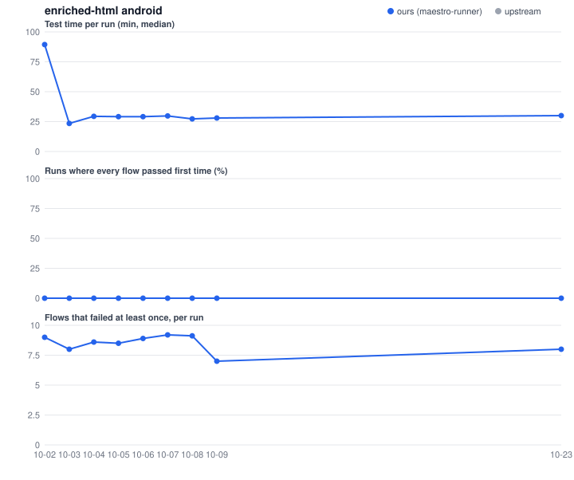
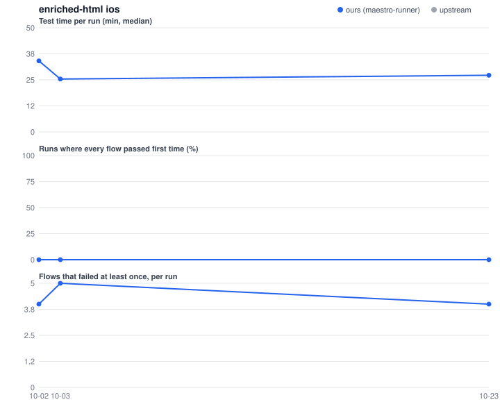

## [expo](expo.md)

Each cell: **ours vs upstream**; the better one in bold. Ours is the newest maestro-runner build.

| Job | Build | Runs | Test time / run (min) | Every flow passed first time | Flows that failed at least once / run | Runs needing a retry job | Extra flow runs / run | Runs ending with a failed flow | Most often failing (ours / upstream) |
|---|---|---|---|---|---|---|---|---|---|
| android | e8a87b5 | 29 vs 106 | 25.9 vs **12.8** | 17% vs **40%** | 3.48 vs **1.48** | 0% vs 0% | 24.8 vs **6.6** | 48% vs **11%** | fullscreen-test ×19, picture-in-picture-test.android ×17, test ×15 / fullscreen-test ×40, maestro-generated ×37, picture-in-picture-test.android ×31 |
| ios | e8a87b5 | 28 vs 98 | **11.1** vs 15.9 | **57%** vs 40% | **0.46** vs 1.00 | 0% vs 0% | **0.5** vs 1.3 | **0%** vs 14% | fullscreen-test ×7, playback-test ×3, test ×3 / fullscreen-test ×44, playback-test ×22, maestro-generated ×18 |

Ours on earlier maestro-runner builds:

| Job | Build | Runs | Test time / run (min) | Every flow passed first time | Flows that failed at least once / run | Runs needing a retry job | Extra flow runs / run | Runs ending with a failed flow | Most often failing |
|---|---|---|---|---|---|---|---|---|---|
| android | 6904d0f | 6 | 12.4 | 0% | 1.50 | 0% | 4.3 | 0% | fullscreen-test ×5, picture-in-picture-test.android ×2, maestro-generated ×1 |
| ios | 6904d0f | 5 | 9.6 | 20% | 0.80 | 0% | 0.8 | 0% | fullscreen-test ×2, test ×1, playback-test ×1 |

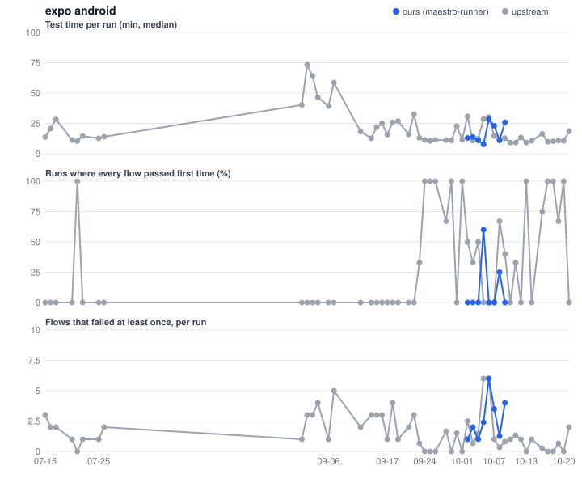
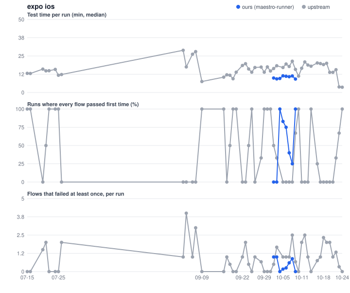

## [pager-view](pager-view.md)

Each cell: **ours vs upstream**; the better one in bold. Ours is the newest maestro-runner build.

| Job | Build | Runs | Test time / run (min) | Every flow passed first time | Flows that failed at least once / run | Runs needing a retry job | Extra flow runs / run | Runs ending with a failed flow | Most often failing (ours / upstream) |
|---|---|---|---|---|---|---|---|---|---|
| android | e8a87b5 | 17 | 20.0 | 0% | 8.65 | 0% | 17.1 | 100% | nested_pagerView_example ×17, ensure-ltr ×17, ensure-rtl ×17 / - |
| ios | e8a87b5 | 18 | 10.1 | 0% | 3.17 | 0% | 6.1 | 100% | ensure-rtl ×18, verify-horizontal-rtl-swipe ×18, ensure-ltr ×16 / - |

Ours on earlier maestro-runner builds:

| Job | Build | Runs | Test time / run (min) | Every flow passed first time | Flows that failed at least once / run | Runs needing a retry job | Extra flow runs / run | Runs ending with a failed flow | Most often failing |
|---|---|---|---|---|---|---|---|---|---|
| android | 6904d0f | 16 | 19.8 | 0% | 8.19 | 0% | 16.1 | 100% | ensure-ltr ×16, ensure-rtl ×16, verify-horizontal-rtl-swipe ×16 |
| ios | 6904d0f | 17 | 8.8 | 0% | 3.06 | 0% | 6.1 | 100% | ensure-ltr ×17, ensure-rtl ×17, verify-horizontal-rtl-swipe ×17 |

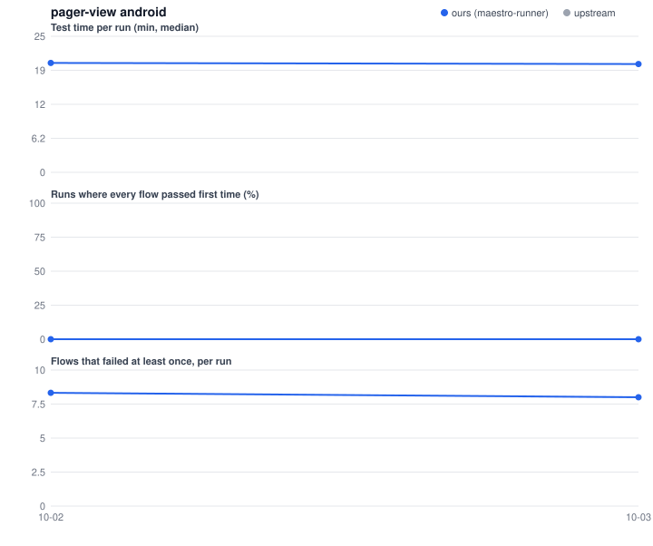
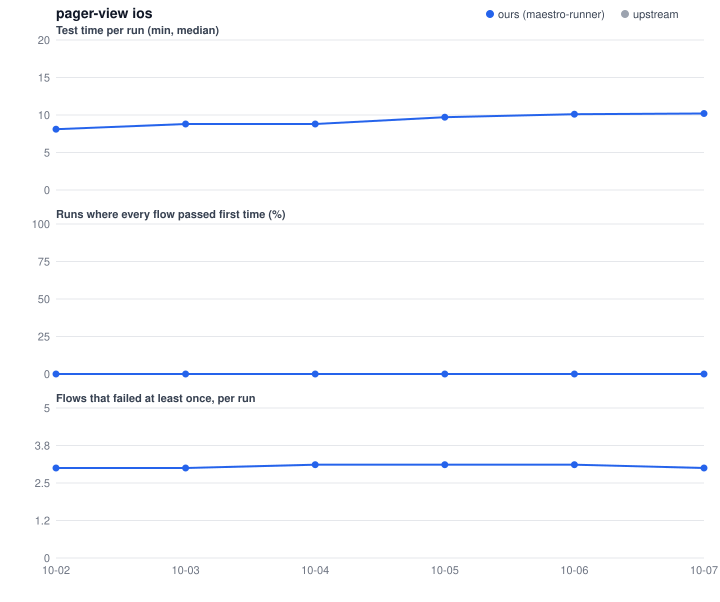

## [react-native](react-native.md)

Each cell: **ours vs upstream**; the better one in bold. Ours is the newest maestro-runner build.

| Job | Build | Runs | Test time / run (min) | Every flow passed first time | Flows that failed at least once / run | Runs needing a retry job | Extra flow runs / run | Runs ending with a failed flow | Most often failing (ours / upstream) |
|---|---|---|---|---|---|---|---|---|---|
| android debug rntester | e8a87b5 | 27 vs 329 | **11.6** vs 18.8 | 93% vs **95%** | 1.85 vs **1.15** | **4%** vs 6% | **0.8** vs 1.3 | 7% vs **1%** | alert ×2, animated-fade-in-view ×2, appearance ×2 / animated-fade-in-view ×16, image-progressive-jpeg ×16, text ×16 |
| android debug templateapp | e8a87b5 | 26 vs 325 | **2.8** vs 3.2 | **96%** vs 95% | **0.04** vs 0.05 | 8% vs **5%** | 0.2 vs **0.1** | **0%** vs 1% | start ×1 / start ×17 |
| android release rntester | e8a87b5 | 27 vs 329 | **15.1** vs 27.8 | **100%** vs 95% | **0.00** vs 1.67 | **0%** vs 6% | **0.0** vs 2.0 | **0%** vs 1% | - / flatlist-momentum-scroll-maintainvisible ×12, flatlist-orientation-maintainvisible ×12, flatlist-pull-to-refresh-maintainvisible ×12 |
| android release templateapp | e8a87b5 | 26 vs 325 | **2.2** vs 2.5 | **96%** vs 95% | **0.04** vs 0.05 | 8% vs **5%** | 0.2 vs **0.1** | **0%** vs 1% | start ×1 / start ×16 |
| ios debug rntester | e8a87b5 | 29 vs 335 | **26.5** vs 148.7 | **72%** vs 14% | 2.83 vs **1.74** | **14%** vs 56% | 44.9 vs **37.7** | **14%** vs 18% | alert ×4, flatlist-append-maintainvisible ×4, flatlist-delete-anchor-maintainvisible ×4 / sectionlist-viewability ×174, flatlist ×35, flatlist-viewability ×20 |
| ios debug templateapp | e8a87b5 | 26 vs 311 | **8.4** vs 10.5 | 85% vs **92%** | 0.15 vs **0.08** | **0%** vs 3% | 0.2 vs **0.1** | 0% vs 0% | start ×4 / start ×24 |
| ios release rntester | e8a87b5 | 29 vs 337 | **23.8** vs 148.3 | **83%** vs 32% | 2.66 vs **0.73** | **14%** vs 57% | 44.7 vs **40.7** | 14% vs **13%** | flatlist-horizontal-inverted-recycle-maintainvisible ×5, flatlist-append-maintainvisible ×4, flatlist-delete-anchor-maintainvisible ×4 / sectionlist-viewability ×208, flatlist-append-maintainvisible ×11, alert ×5 |
| ios release templateapp | e8a87b5 | 26 vs 312 | **6.3** vs 9.6 | 100% vs 100% | 0.00 vs 0.00 | **0%** vs 3% | 0.0 vs 0.0 | 0% vs 0% | - / - |

Ours on earlier maestro-runner builds:

| Job | Build | Runs | Test time / run (min) | Every flow passed first time | Flows that failed at least once / run | Runs needing a retry job | Extra flow runs / run | Runs ending with a failed flow | Most often failing |
|---|---|---|---|---|---|---|---|---|---|
| android debug rntester | 6904d0f | 14 | 11.9 | 86% | 3.57 | 14% | 3.6 | 0% | alert ×2, animated-fade-in-view ×2, appearance ×2 |
| android debug templateapp | 6904d0f | 14 | 2.7 | 100% | 0.00 | 0% | 0.0 | 0% | - |
| android release rntester | 6904d0f | 14 | 15.6 | 93% | 0.07 | 0% | 0.1 | 0% | image-getsize-local-drawables ×1 |
| android release templateapp | 6904d0f | 14 | 2.1 | 93% | 0.07 | 7% | 0.4 | 0% | start ×1 |
| ios debug rntester | 6904d0f | 14 | 22.4 | 86% | 0.14 | 0% | 0.1 | 0% | flatlist-complex-mutations-maintainvisible ×1, image ×1 |
| ios debug templateapp | 6904d0f | 14 | 8.1 | 93% | 0.07 | 0% | 0.1 | 0% | start ×1 |
| ios release rntester | 6904d0f | 14 | 21.5 | 79% | 0.29 | 0% | 0.3 | 0% | flatlist-orientation-maintainvisible ×2, image ×2 |
| ios release templateapp | 6904d0f | 14 | 5.8 | 100% | 0.00 | 0% | 0.0 | 0% | - |

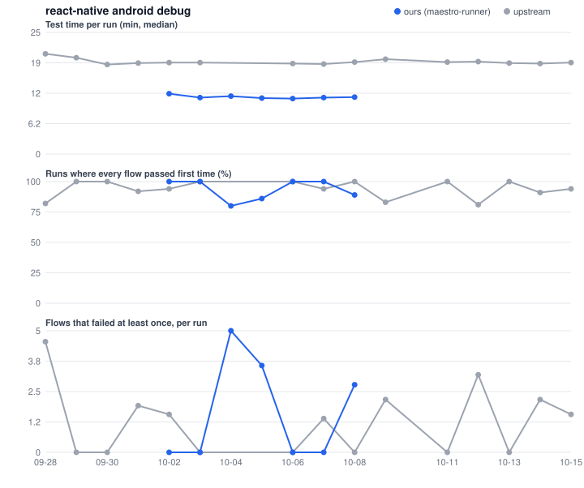
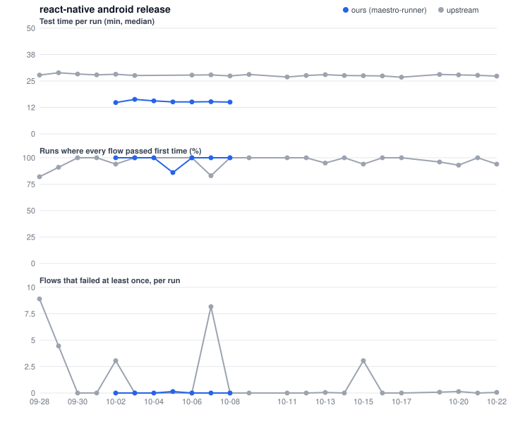
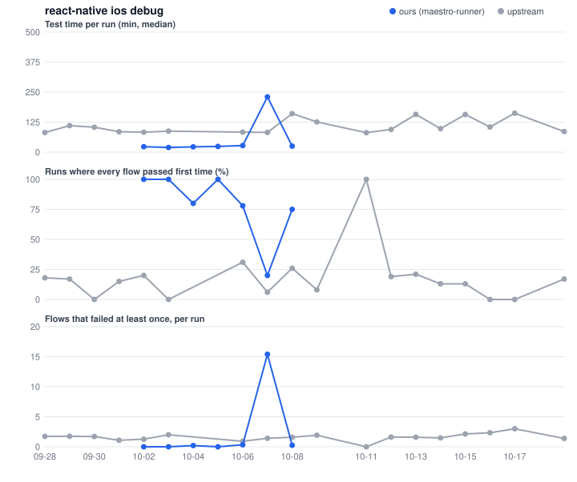
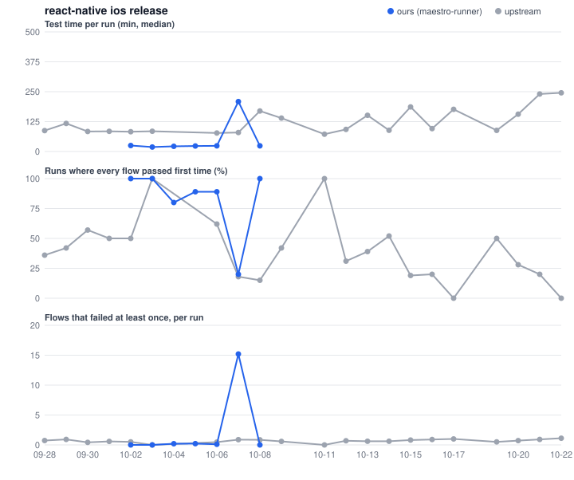

## [react-navigation](react-navigation.md)

Each cell: **ours vs upstream**; the better one in bold. Ours is the newest maestro-runner build.

| Job | Build | Runs | Test time / run (min) | Every flow passed first time | Flows that failed at least once / run | Runs needing a retry job | Extra flow runs / run | Runs ending with a failed flow | Most often failing (ours / upstream) |
|---|---|---|---|---|---|---|---|---|---|
| android | e8a87b5 | 29 vs 85 | 26.2 vs **24.1** | **90%** vs 78% | **0.10** vs 0.25 | 0% vs 0% | **0.1** vs 0.3 | 0% vs 0% | Tab View - Coverflow ×1, Tab View - Custom Tab Bar ×1, Showcase - Material Top Tabs ×1 / Tab View - Scrollable Tab Bar ×7, Bottom Tabs - Preload Flow ×5, Loaders ×2 |
| ios | e8a87b5 | 29 vs 97 | **18.2** vs 24.8 | **93%** vs 56% | **0.07** vs 0.52 | 0% vs 0% | **0.1** vs 0.6 | 0% vs 0% | Auth Flow ×2 / Screen Layout ×8, Tab View - Scrollable Tab Bar ×8, Stack - Prevent Remove ×5 |

Ours on earlier maestro-runner builds:

| Job | Build | Runs | Test time / run (min) | Every flow passed first time | Flows that failed at least once / run | Runs needing a retry job | Extra flow runs / run | Runs ending with a failed flow | Most often failing |
|---|---|---|---|---|---|---|---|---|---|
| android | 6904d0f | 17 | 26.2 | 82% | 0.24 | 0% | 0.3 | 0% | Tab View - Scrollable Tab Bar ×2, Tab View - Coverflow ×1, Tab View - Custom Tab Bar ×1 |
| ios | 6904d0f | 17 | 19.0 | 82% | 0.18 | 0% | 0.2 | 0% | Screen Layout ×2, Material Top Tabs - Basic ×1 |

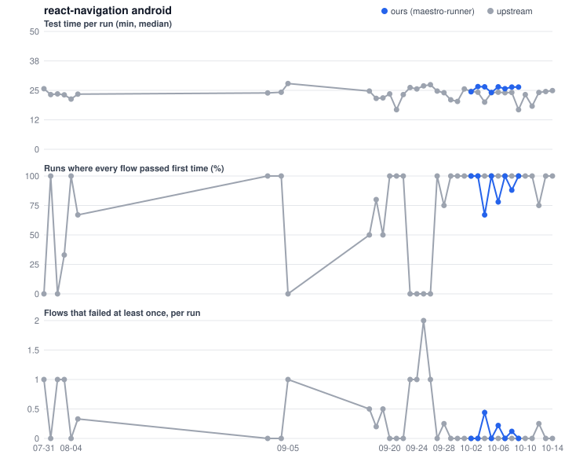
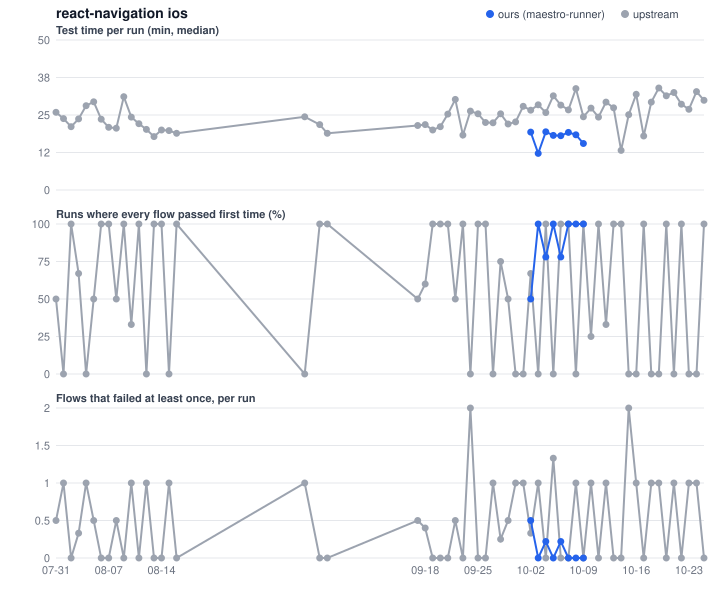
